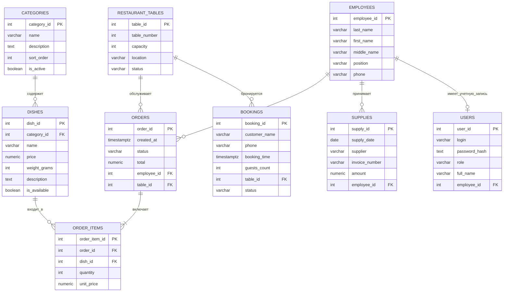
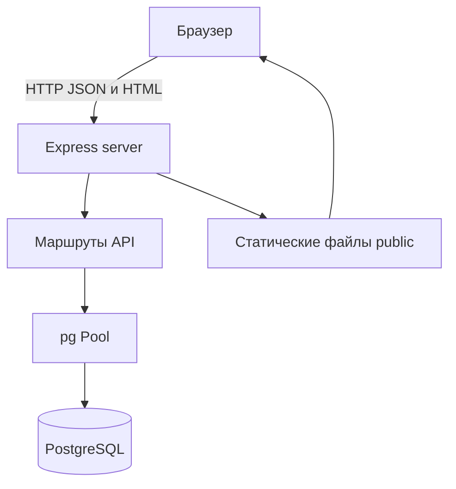

# План реализации веб-приложения «Ресторан Ирис»

## 1. Результаты анализа лабораторных работ

Источники: [`lab/Иконникова_24м_лаб1.docx`](lab/Иконникова_24м_лаб1.docx), [`lab/Иконникова_24м_лаб2.docx`](lab/Иконникова_24м_лаб2.docx), [`lab/Иконникова_24м_лаб2_1.docx`](lab/Иконникова_24м_лаб2_1.docx), [`lab/Иконникова_24м_лаб3.docx`](lab/Иконникова_24м_лаб3.docx), [`lab/Иконникова_24м_лаб5.docx`](lab/Иконникова_24м_лаб5.docx), [`lab/Иконникова_24м_PostgreSQL.docx`](lab/Иконникова_24м_PostgreSQL.docx).

Предметная область: ресторан японской кухни «Ирис». Основные процессы: приём поставок, бронирование столов, приём и приготовление заказа, подача и оплата, инвентаризация, анализ продаж.

Выделенные сущности и связи:

| Сущность | Ключевые атрибуты | Связи |
|---|---|---|
| Категории блюд | id, название, описание, порядок вывода, активна | 1:M с блюдами |
| Блюда | id, название, цена, вес, описание, id категории | M:1 с категорией, M:M с заказами через состав |
| Сотрудники | id, фамилия, имя, отчество, должность, телефон | 1:M с заказами и поставками |
| Столы | id, номер, вместимость, расположение, статус | 1:M с заказами и бронированиями |
| Заказы | id, дата и время, статус, сумма, id сотрудника, id стола | 1:M с составом заказа |
| Состав заказа | id, id заказа, id блюда, количество, цена на момент заказа | ассоциативная сущность M:M |
| Поставки | id, дата, поставщик, номер накладной, сумма, id сотрудника | M:1 с сотрудником |
| Бронирования | id, ФИО клиента, телефон, дата и время, количество гостей, id стола, статус | M:1 со столом |
| Пользователи | id, логин, хеш пароля, роль, ФИО, id сотрудника | нужна для входа по ролям |

Бизнес-правила, которые нужно отразить в БД и API:

- цена и вес блюда положительные;
- вместимость стола положительная, статус только из допустимого набора;
- статус заказа только из жизненного цикла: новый, готовится, подан, оплачен, закрыт, отменён;
- нельзя закрыть заказ без оплаты;
- нельзя дважды забронировать один стол на одно и то же время;
- количество гостей не должно превышать вместимость стола;
- нельзя заказать несуществующее или недоступное блюдо;
- сумма заказа рассчитывается на сервере по актуальным ценам БД, а не принимается от клиента;
- удаление блюда, входящего в заказ, запрещено через `ON DELETE RESTRICT`;
- персональные данные клиентов и сотрудников не должны попадать в публичные ответы API.

## 2. Модель базы данных

Идентификаторы таблиц и колонок — на английском в snake_case, отображаемые подписи — на русском во фронтенде.

### 2.1. Таблицы

**categories**

- `category_id SERIAL PRIMARY KEY`
- `name VARCHAR(100) NOT NULL UNIQUE`
- `description TEXT`
- `sort_order INTEGER NOT NULL DEFAULT 0 CHECK (sort_order >= 0)`
- `is_active BOOLEAN NOT NULL DEFAULT TRUE`

**dishes**

- `dish_id SERIAL PRIMARY KEY`
- `category_id INTEGER NOT NULL REFERENCES categories(category_id) ON DELETE RESTRICT`
- `name VARCHAR(150) NOT NULL`
- `price NUMERIC(10,2) NOT NULL CHECK (price > 0)`
- `weight_grams INTEGER CHECK (weight_grams > 0)`
- `description TEXT`
- `is_available BOOLEAN NOT NULL DEFAULT TRUE`
- `created_at TIMESTAMPTZ NOT NULL DEFAULT NOW()`

**employees**

- `employee_id SERIAL PRIMARY KEY`
- `last_name VARCHAR(100) NOT NULL`
- `first_name VARCHAR(100) NOT NULL`
- `middle_name VARCHAR(100)`
- `position VARCHAR(50) NOT NULL CHECK (position IN ('директор','администратор','официант','повар','кладовщик','бармен'))`
- `phone VARCHAR(20) NOT NULL CHECK (phone ~ '^[0-9+() -]{10,20}$')`
- `is_active BOOLEAN NOT NULL DEFAULT TRUE`

**restaurant_tables**

- `table_id SERIAL PRIMARY KEY`
- `table_number INTEGER NOT NULL UNIQUE CHECK (table_number > 0)`
- `capacity INTEGER NOT NULL CHECK (capacity BETWEEN 1 AND 20)`
- `location VARCHAR(50) NOT NULL CHECK (location IN ('зал','центр','у окна','vip-зона','терраса'))`
- `status VARCHAR(20) NOT NULL DEFAULT 'свободен' CHECK (status IN ('свободен','забронирован','занят'))`

**orders**

- `order_id SERIAL PRIMARY KEY`
- `created_at TIMESTAMPTZ NOT NULL DEFAULT NOW()`
- `status VARCHAR(20) NOT NULL DEFAULT 'новый' CHECK (status IN ('новый','готовится','подан','оплачен','закрыт','отменён'))`
- `total NUMERIC(10,2) NOT NULL DEFAULT 0 CHECK (total >= 0)`
- `employee_id INTEGER NOT NULL REFERENCES employees(employee_id) ON DELETE RESTRICT`
- `table_id INTEGER NOT NULL REFERENCES restaurant_tables(table_id) ON DELETE RESTRICT`

**order_items**

- `order_item_id SERIAL PRIMARY KEY`
- `order_id INTEGER NOT NULL REFERENCES orders(order_id) ON DELETE CASCADE`
- `dish_id INTEGER NOT NULL REFERENCES dishes(dish_id) ON DELETE RESTRICT`
- `quantity INTEGER NOT NULL CHECK (quantity BETWEEN 1 AND 100)`
- `unit_price NUMERIC(10,2) NOT NULL CHECK (unit_price > 0)`
- `UNIQUE (order_id, dish_id)`

**supplies**

- `supply_id SERIAL PRIMARY KEY`
- `supply_date DATE NOT NULL DEFAULT CURRENT_DATE`
- `supplier VARCHAR(150) NOT NULL`
- `invoice_number VARCHAR(50) NOT NULL UNIQUE`
- `amount NUMERIC(12,2) NOT NULL CHECK (amount >= 0)`
- `employee_id INTEGER NOT NULL REFERENCES employees(employee_id) ON DELETE RESTRICT`

**bookings**

- `booking_id SERIAL PRIMARY KEY`
- `customer_name VARCHAR(150) NOT NULL`
- `phone VARCHAR(20) NOT NULL CHECK (phone ~ '^[0-9+() -]{10,20}$')`
- `booking_time TIMESTAMPTZ NOT NULL`
- `guests_count INTEGER NOT NULL CHECK (guests_count > 0)`
- `table_id INTEGER NOT NULL REFERENCES restaurant_tables(table_id) ON DELETE RESTRICT`
- `status VARCHAR(20) NOT NULL DEFAULT 'подтверждена' CHECK (status IN ('новая','подтверждена','отменена','выполнена'))`
- `created_at TIMESTAMPTZ NOT NULL DEFAULT NOW()`
- `UNIQUE (table_id, booking_time)`

**users**

- `user_id SERIAL PRIMARY KEY`
- `login VARCHAR(50) NOT NULL UNIQUE`
- `password_hash TEXT NOT NULL`
- `role VARCHAR(20) NOT NULL CHECK (role IN ('admin','guest'))`
- `full_name VARCHAR(150) NOT NULL`
- `employee_id INTEGER REFERENCES employees(employee_id) ON DELETE SET NULL`
- `created_at TIMESTAMPTZ NOT NULL DEFAULT NOW()`

### 2.2. Индексы

- `idx_dishes_category` на `dishes(category_id)`;
- `idx_orders_employee` на `orders(employee_id)`;
- `idx_orders_table` на `orders(table_id)`;
- `idx_orders_created_at` на `orders(created_at)`;
- `idx_order_items_order` на `order_items(order_id)`;
- `idx_bookings_table_time` на `bookings(table_id, booking_time)`;
- `idx_bookings_time` на `bookings(booking_time)`.

### 2.3. ER-диаграмма



## 3. Архитектура приложения



- Backend: Node.js + Express + TypeScript, доступ к PostgreSQL через `pg.Pool`.
- Frontend: статические HTML-страницы, общий CSS, TypeScript-модули, компилируемые в `public/js`.
- Аутентификация: `express-session`, пароли хранятся как хеш `pgcrypto.crypt` с `gen_salt('bf')`.
- Все SQL-запросы параметризованы, данные клиента не подставляются в строку запроса.
- Сумма заказа считается в транзакции на сервере, клиент передаёт только `dish_id` и `quantity`.
- Ошибки API возвращаются в едином формате `{ "error": "текст" }` с корректным HTTP-статусом.

## 4. Структура проекта

```text
restaurant/
├── db/
│   ├── schema.sql
│   └── seed.sql
├── src/
│   ├── server.ts
│   ├── config/
│   │   └── db.ts
│   ├── middleware/
│   │   ├── auth.ts
│   │   └── errors.ts
│   ├── routes/
│   │   ├── auth.routes.ts
│   │   ├── menu.routes.ts
│   │   ├── tables.routes.ts
│   │   ├── employees.routes.ts
│   │   ├── orders.routes.ts
│   │   └── bookings.routes.ts
│   └── types/
│       └── index.ts
├── client/
│   ├── api.ts
│   ├── types.ts
│   ├── common.ts
│   ├── login.ts
│   ├── menu.ts
│   └── order.ts
├── public/
│   ├── login.html
│   ├── index.html
│   ├── order.html
│   ├── css/
│   │   └── styles.css
│   └── js/
│       └── скомпилированные модули
├── plans/
│   └── restaurant-app-plan.md
├── package.json
├── tsconfig.json
├── tsconfig.client.json
├── .env.example
└── README.md
```

## 5. API

| Метод | Путь | Доступ | Назначение |
|---|---|---|---|
| POST | `/api/auth/login` | все | Вход по логину и паролю, создание сессии |
| POST | `/api/auth/logout` | авторизованные | Выход |
| GET | `/api/auth/me` | авторизованные | Текущий пользователь и роль |
| GET | `/api/menu` | все | Активные категории с доступными блюдами |
| GET | `/api/categories` | все | Список категорий |
| GET | `/api/dishes` | все | Блюда с фильтрами `category_id`, `search` |
| GET | `/api/dishes/:id` | все | Карточка блюда |
| GET | `/api/tables` | все | Столы, фильтры `status`, `guests` |
| GET | `/api/tables/free` | все | Свободные столы на дату и время с учётом броней |
| GET | `/api/employees` | admin | Сотрудники, фильтр `position` |
| POST | `/api/orders` | admin | Создание заказа с составом в транзакции |
| GET | `/api/orders` | admin | Заказы с фильтрами `status`, `date` |
| GET | `/api/orders/:id` | admin | Заказ с составом |
| PATCH | `/api/orders/:id/status` | admin | Смена статуса с проверкой допустимого перехода |
| POST | `/api/bookings` | guest и admin | Бронирование стола |
| GET | `/api/bookings` | admin | Брони на дату |
| PATCH | `/api/bookings/:id/status` | admin | Подтверждение, отмена, выполнение брони |

### 5.1. Создание заказа

Тело запроса:

```json
{
  "tableId": 3,
  "employeeId": 4,
  "items": [
    { "dishId": 1, "quantity": 2 },
    { "dishId": 7, "quantity": 1 }
  ]
}
```

Алгоритм:

1. Проверить авторизацию и роль admin.
2. Проверить, что стол существует, а сотрудник активен и имеет должность официант.
3. Проверить, что список блюд не пуст, количества в диапазоне 1–100, блюда доступны.
4. Начать транзакцию `BEGIN`.
5. Получить актуальные цены блюд из БД.
6. Рассчитать `total`.
7. Вставить заказ и позиции состава.
8. Перевести стол в статус `занят`.
9. Выполнить `COMMIT`, при ошибке — `ROLLBACK`.

### 5.2. Допустимые переходы статусов заказа

```text
новый -> готовится | отменён
готовится -> подан | отменён
подан -> оплачен | отменён
оплачен -> закрыт
закрыт -> нет переходов
отменён -> нет переходов
```

Правило «нельзя закрыть без оплаты» обеспечивается отсутствием перехода `подан -> закрыт`. При переводе в `закрыт`, `отменён` или `оплачен` стол освобождается.

### 5.3. Бронирование

- Проверка вместимости стола: `guests_count <= capacity`.
- Проверка, что время брони не в прошлом.
- Проверка конфликта: нет другой активной брони этого стола в том же времени.
- Уникальное ограничение `UNIQUE (table_id, booking_time)` дополнительно защищает от гонок.
- Для брони на текущий день стол получает статус `забронирован`.

## 6. Роли и доступ

| Возможность | Гость | Администратор |
|---|---|---|
| Просмотр меню и категорий | да | в панели управления (вкладка «Блюда») |
| Поиск и фильтрация блюд | да | в панели управления (вкладка «Блюда») |
| Бронирование стола | да | да |
| Просмотр списка броней | нет | да |
| Оформление заказа | нет | да |
| Просмотр заказов и смена статуса | нет | да |
| Выбор официанта и стола | нет | да |

Демонстрационные учётные записи:

- `admin` / `admin123` — роль admin;
- `guest` / `guest123` — роль guest.

Пароли в БД хранятся через `crypt(password, gen_salt('bf'))`, проверка — сравнением с `password_hash`.

## 7. Фронтенд

### 7.1. Страницы

- [`public/login.html`](public/login.html) — экран входа с двумя демо-ролями и формой.
- [`public/index.html`](public/index.html) — «Меню» для гостя: hero-блок, фильтры категорий, поиск, карточки блюд, кнопка бронирования. Администратора страница перенаправляет в панель управления.
- [`public/order.html`](public/order.html) — «Оформление заказа»: выбор свободного стола, выбор официанта, каталог блюд с количеством, корзина и итоговая сумма. Для администратора здесь же вкладки «Заказы» и «Брони» со сменой статусов.

### 7.2. Общий интерфейс

- Единый стиль «Ирис»: глубокий сливовый и фиолетовый, кремовый фон, золотые акценты.
- Адаптивная сетка карточек, липкая шапка, чипы категорий, модальное окно бронирования, toast-уведомления.
- Состояния загрузки, пустые состояния и сообщения об ошибках.
- Навигация скрывает недоступные разделы: гостю — панель управления, администратору — раздел «Меню».
- Все подписи и сообщения на русском языке.

### 7.3. Клиентские модули

- [`client/api.ts`](client/api.ts) — обёртка над `fetch`, обработка 401/403 и ошибок.
- [`client/types.ts`](client/types.ts) — типы ответов API.
- [`client/common.ts`](client/common.ts) — шапка, проверка сессии, toast, форматирование цен и дат.
- [`client/login.ts`](client/login.ts) — вход и перенаправление по роли.
- [`client/menu.ts`](client/menu.ts) — загрузка меню, фильтры, поиск, бронирование (только для гостя).
- [`client/order.ts`](client/order.ts) — корзина, создание заказа, списки заказов и броней, смена статусов.

## 8. Конфигурация и запуск

### 8.1. package.json

Зависимости:

- `express`, `pg`, `dotenv`, `express-session`;
- dev: `typescript`, `ts-node`, `@types/node`, `@types/express`, `@types/express-session`, `@types/pg`.

Скрипты:

- `dev` — запуск сервера через `ts-node src/server.ts`;
- `build:client` — компиляция фронтенда;
- `build` — компиляция сервера и фронтенда;
- `start` — запуск собранного сервера из `dist`;
- `db:init` — применение `db/schema.sql`;
- `db:seed` — применение `db/seed.sql`.

### 8.2. tsconfig.json

Для сервера: `target ES2020`, `module commonjs`, `outDir dist`, `rootDir src`, `strict true`, `esModuleInterop true`, `skipLibCheck true`, `sourceMap true`.

### 8.3. tsconfig.client.json

Для фронтенда: `target ES2020`, `module ES2020`, `moduleResolution bundler`, `lib DOM и ES2020`, `outDir public/js`, `rootDir client`, `strict true`. Импорты в клиентском коде указываются с расширением `.js`.

### 8.4. .env.example

```env
PORT=3000
DB_HOST=localhost
DB_PORT=5432
DB_NAME=iris_restaurant
DB_USER=postgres
DB_PASSWORD=postgres
SESSION_SECRET=change_me_in_production
```

### 8.5. Порядок запуска

```bash
npm install
createdb iris_restaurant
psql -d iris_restaurant -f db/schema.sql
psql -d iris_restaurant -f db/seed.sql
copy .env.example .env
npm run build:client
npm run dev
```

Приложение открывается по адресу `http://localhost:3000/login.html`.

## 9. Тестовые данные

- 6 категорий: суши, роллы, горячие блюда, супы, напитки, десерты.
- 18 блюд японской кухни с ценами, весом и описанием.
- 10 сотрудников: директор, администратор, 3 официанта, 2 повара, кладовщик и бармен.
- 10 столов с разной вместимостью и расположением.
- 3 заказа с составом и разными статусами.
- 3 поставки с номерами накладных.
- 3 бронирования на текущую и будущие даты.
- 2 пользователя: admin и guest.

Скрипт `db/seed.sql` начинается с `TRUNCATE ... RESTART IDENTITY CASCADE`, поэтому его можно запускать повторно.

## 10. Порядок реализации

1. Создать `db/schema.sql` с расширением `pgcrypto`, таблицами, ограничениями и индексами.
2. Создать `db/seed.sql` с тестовыми данными и пользователями.
3. Обновить `package.json`, добавить `tsconfig.json`, `tsconfig.client.json`, `.env.example`.
4. Реализовать подключение к PostgreSQL и каркас Express-сервера.
5. Реализовать сессии, вход, выход, `me` и middleware ролей.
6. Реализовать API меню, категорий и блюд.
7. Реализовать API столов, свободных столов и сотрудников.
8. Реализовать API бронирований с проверкой конфликтов и вместимости.
9. Реализовать API заказов с транзакцией, расчётом суммы и переходами статусов.
10. Сверстать общий CSS и страницу входа.
11. Сверстать страницу меню с фильтрами, поиском и модальным бронированием.
12. Сверстать страницу оформления заказа с корзиной и админ-вкладками.
13. Скомпилировать клиентский TypeScript и проверить сценарии end-to-end.
14. Написать README с инструкцией запуска и описанием демо-учётных записей.

## 11. Критерии готовности

- `npm install` и `npm run build` завершаются без ошибок TypeScript.
- `db/schema.sql` и `db/seed.sql` применяются на чистой базе PostgreSQL.
- Вход под admin и guest работает, роли разграничивают доступ.
- Гость видит меню и может забронировать стол.
- Администратор создаёт заказ, сумма считается на сервере, стол становится занятым.
- Смена статуса заказа валидируется, при закрытии или отмене стол освобождается.
- Попытка гостя открыть API заказов возвращает 403.
- Повторная бронь того же стола на то же время отклоняется с понятной ошибкой.
